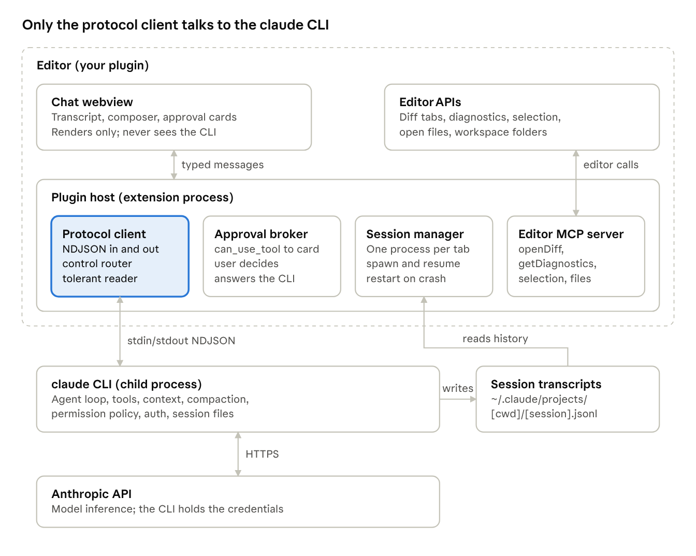
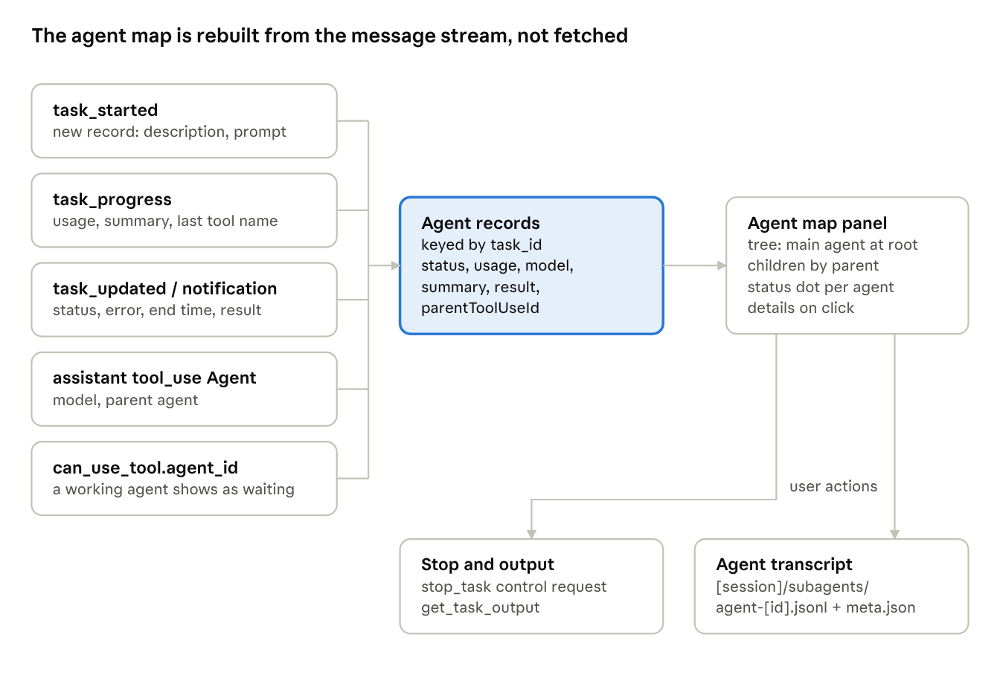
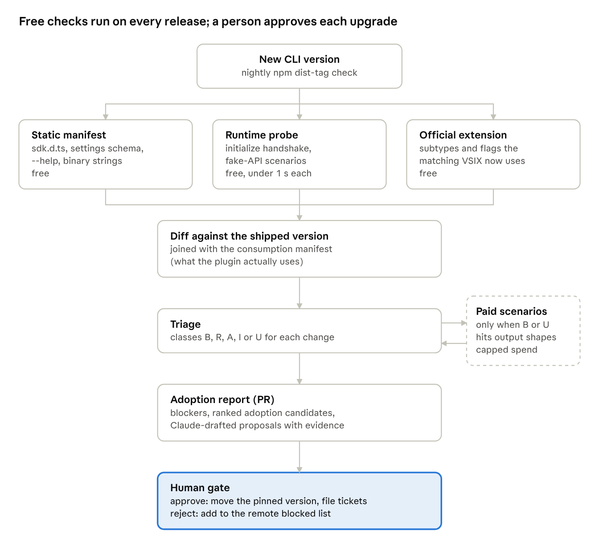

# Claude Chat Plugin — Technical Specification

Nov 15, 2026 · @Trevor Samaroo

## Overview

The plugin hosts a full Claude chat panel inside an editor by running the `claude` CLI as a child process and speaking its line-delimited JSON protocol ("stream-json") over stdin/stdout. Nothing in the plugin calls the Anthropic API directly: the CLI owns the model loop, tools, context, sessions and auth; the plugin owns the UI, approvals and editor integration.

This spec was derived from the official Claude Code VS Code extension, `anthropic.claude-code` 2.1.325 (linux-x64 VSIX). That extension embeds the `@anthropic-ai/claude-agent-sdk` TypeScript package, which spawns the bundled native binary. Field names below come from that bundle.

**Goals**

- Feature parity with the reference chat panel: streaming replies, tool cards, inline approvals, diffs, plan mode, model and mode switching, session history, rewind, MCP management.
- A clean boundary: UI ⇄ plugin host ⇄ CLI process, each replaceable.
- Survive CLI upgrades: depend only on the stable protocol surface (section 5 marks the rest).

**Non-goals**

- Re-implementing the agent loop, tools or prompt assembly. The CLI does that.
- Calling the Messages API directly or managing API keys inside the plugin.
- Internal reference-extension features: cloud sessions, Chrome control, voice, ultrareview, remote control.

**Assumptions**

- The host plugin locates, versions and launches the `claude` binary itself (no bundled copy required).
- The user has already logged in with `claude` (or has `ANTHROPIC_API_KEY` set). The plugin surfaces login state but does not own credentials.
- Recommended implementation path: use the Agent SDK (`query()`) with `pathToClaudeCodeExecutable` pointed at the managed binary. Sections 3–5 document the raw protocol so a non-TypeScript host can implement it directly.

**Stability levels used in this spec**

| Label | Meaning |
| --- | --- |
| Stable | Exposed as a public SDK option or method; safe to depend on |
| Observed | Present in 2.1.325 and used by the reference extension, not documented; pin the CLI version |
| Internal | Do not use; listed only so you can ignore it |

## Architecture



The webview renders and the host decides; only the protocol client writes to the CLI's stdin or reads its stdout. The approval broker, session manager and editor MCP server all go through the protocol client, so a single place handles framing, request ids and unknown message types.

| Component | Owns | Talks to |
| --- | --- | --- |
| Chat webview | Rendering, input, local UI state | Host only, via typed messages |
| Protocol client | Process I/O, NDJSON, control request/response pairing | CLI |
| Approval broker | Pending `can_use_tool` requests and their cards | Protocol client, webview |
| Session manager | Process per tab, resume/restart, session list from JSONL | Protocol client, file system |
| Editor MCP server | Editor tools exposed to Claude | Protocol client (`mcp_message`), editor APIs |

## CLI process lifecycle

One chat tab = one long-lived `claude` child process, started on the tab's first message and kept alive across turns. The plugin writes user turns and control messages to its stdin and reads NDJSON from its stdout; stderr is a diagnostic log only.

### Discovery

1. Use the user-configured path if set (setting `claude.executablePath`).
2. Otherwise the plugin-managed install location for the pinned version.
3. Otherwise `claude` on `PATH`.
4. Run `claude --version` once per path and cache it; refuse to start below the minimum supported version (section 13) with an actionable error.

Support an optional process wrapper (command + args prefix) for users who run the CLI through `ssh`, `docker exec` or a version manager; the reference extension exposes this as `claudeProcessWrapper`.

### Spawn command

Always-on flags (Stable):

```
claude --output-format stream-json --input-format stream-json --verbose
```

Conditional flags, each mapped from a plugin option:

| Flag | When | Purpose |
| --- | --- | --- |
| `--permission-prompt-tool stdio` | always for an interactive UI | Routes tool approvals to the host as `can_use_tool` control requests |
| `--include-partial-messages` | always (local) | Emits `stream_event` token deltas for live streaming |
| `--resume <sessionId>` | reopening a past chat | Loads that transcript |
| `--continue` | "continue last chat" | Resumes most recent session in cwd |
| `--fork-session` | with `--resume` | Branch into a new session id |
| `--resume-session-at <uuid>` | rewind/fork from a message | Resume truncated at that message |
| `--model <id>` / `--fallback-model <id>` | model picker | Initial model |
| `--permission-mode <mode>` | mode picker | `default`, `acceptEdits`, `plan`, `bypassPermissions` |
| `--thinking=adaptive` / `--thinking=disabled` / `--max-thinking-tokens N` | thinking toggle | Extended thinking |
| `--effort <level>` | effort picker | Reasoning effort |
| `--mcp-config <json>` / `--strict-mcp-config` | plugin-provided MCP servers | Adds servers (e.g. the IDE server, section 7) |
| `--add-dir <path>` | multi-root workspace | Extra readable/writable roots |
| `--setting-sources user,project,local` | workspace trust | Which settings files load; drop `project,local` for untrusted folders |
| `--allowedTools` / `--disallowedTools` / `--tools` | plugin policy | Tool allow/deny lists |
| `--max-turns N` / `--max-budget-usd N` | optional guards | Hard limits |

The reference extension also passes these Observed flags: `--debug-to-stderr`, `--enable-auth-status` (auth status events), `--no-chrome`, and `--replay-user-messages` (the CLI echoes each user message back with its `uuid`, needed for rewind and edit-and-resend).

### Environment

| Variable | Value | Why |
| --- | --- | --- |
| `CLAUDE_CODE_ENTRYPOINT` | your plugin id (reference uses `claude-vscode`; SDK default `sdk-ts`) | Identifies the client; use your own value |
| `MCP_CONNECTION_NONBLOCKING` | `true` | Don't block the first turn on slow MCP servers |
| `CLAUDE_CODE_EMIT_STARTUP_TIMING` / `CLAUDE_CODE_STARTUP_FAILURE_RESULTS` | `1` | Observed: startup marks and a `result` on startup failure |
| `CLAUDECODE`, `CLAUDE_CODE_CHILD_SESSION`, `TRACEPARENT` | delete | Prevent the child thinking it is nested inside another Claude session |
| `DISABLE_TELEMETRY` | `1` when the editor's telemetry is off | Respect user telemetry choice |
| user-defined | from setting `claude.environmentVariables` | Proxies, `ANTHROPIC_BASE_URL`, Bedrock/Vertex config |

### Startup

1. Spawn with `cwd` = workspace folder containing the active file (or the first root).
2. Immediately send the `initialize` control request (section 5) and await its response with a timeout (reference: retry the spawn once if initialize times out and the process died).
3. Cache the initialize response: slash commands, models, output styles, account. Enable UI features based on what it advertises, not on version numbers.
4. The tab is ready; the first user message can be written. `system/init` arrives at the start of the first turn with session id, tools, MCP server status and model.

### Shutdown and recovery

- Closing the tab: close stdin, wait up to 5 s, then SIGTERM, then SIGKILL.
- Unexpected exit: mark the tab "disconnected", show the last 20 stderr lines, offer **Restart**, which respawns with `--resume <sessionId>` so no history is lost.
- One process per session id. Never run two processes on the same session; the reference waits for the old process to release a session before resuming it.

## Wire protocol

Every message in both directions is one JSON object followed by `\n` (NDJSON, UTF-8). The reader must buffer partial lines, ignore blank lines, and treat unknown `type` or `subtype` values as non-fatal: log them and render a generic "unsupported event" row in debug builds.

### Host → CLI (stdin)

| `type` | Purpose |
| --- | --- |
| `user` | A user turn (text, images, documents) |
| `control_request` | A command to the CLI (section 5) |
| `control_response` | The answer to a CLI-initiated request such as `can_use_tool` |
| `control_cancel_request` | Withdraw a request the host sent earlier |

User turn:

```json
{"type":"user",
 "message":{"role":"user","content":[
   {"type":"text","text":"Why does this test fail?"},
   {"type":"image","source":{"type":"base64","media_type":"image/png","data":"iVBOR..."}}]},
 "parent_tool_use_id":null,
 "session_id":""}
```

`content` may also be a plain string. A user message written while a turn is running is queued by the CLI and picked up at the next safe point (the reference extension shows it as a pending bubble).

### CLI → host (stdout)

| `type` / `subtype` | When | UI use |
| --- | --- | --- |
| `system` / `init` | Start of each turn's session | Session id, model, cwd, tools, MCP server status, permission mode |
| `stream_event` | Many per turn (needs `--include-partial-messages`) | Live typing of text, thinking and tool input |
| `assistant` | Each completed content block | Final text, thinking, `tool_use` blocks |
| `user` | After each tool runs | `tool_result` blocks for tool cards; echoed user turns with `--replay-user-messages` |
| `result` | End of every turn | Stop spinner, cost, usage, errors |
| `system` / `status` | State changes (e.g. compacting) | Status line |
| `system` / `compact_boundary` | After auto or manual compaction | Divider in transcript |
| `system` / `task_started`, `task_progress`, `task_notification`, `task_updated` | Subagents and background tasks | Task cards |
| `system` / `informational`, `model_refusal_fallback` | Notices | Inline notice |
| `tool_progress` | Long-running tool heartbeats | Elapsed time on tool card |
| `tool_use_summary` | Collapsed summaries of tool runs | Card subtitle |
| `rate_limit_event` | Usage-limit warnings | Banner with reset time |
| `auth_status` | Login state (with `--enable-auth-status`) | Login prompt |
| `prompt_suggestion` | After a turn, if enabled | Suggested follow-up chips |
| `control_request` | CLI needs the host (approvals, MCP, hooks) | Section 5 |
| `control_response` | Answer to a host request | Resolve pending promise by `request_id` |
| `keep_alive` | Periodically | Ignore; resets liveness timer |

Every content message carries `session_id`, a `uuid`, and `parent_tool_use_id`. A non-null `parent_tool_use_id` means the message came from a subagent started by that `Task`/`Agent` tool call; nest it under that tool card.

Assistant message (one per completed block; blocks of one API response share `message.id`, so merge by id):

```json
{"type":"assistant","uuid":"7c1…","session_id":"a8f…","parent_tool_use_id":null,
 "message":{"id":"msg_01…","role":"assistant","model":"claude-opus-5-5",
   "content":[{"type":"tool_use","id":"toolu_01…","name":"Edit",
               "input":{"file_path":"/src/app.ts","old_string":"a","new_string":"b"}}],
   "stop_reason":"tool_use","usage":{"input_tokens":12,"output_tokens":40}}}
```

Content block types to render: `text`, `thinking`, `redacted_thinking`, `tool_use`, `server_tool_use`, `web_search_tool_result`, and `tool_result` (in `user` messages). Unknown block types render as a collapsed JSON card.

Streaming event: `event` is the raw Messages API SSE event (`message_start`, `content_block_start`, `content_block_delta` with `text_delta` / `thinking_delta` / `input_json_delta`, `content_block_stop`, `message_delta`, `message_stop`). Render deltas optimistically, then replace them with the authoritative `assistant` block when it arrives.

```json
{"type":"stream_event","session_id":"a8f…","parent_tool_use_id":null,
 "event":{"type":"content_block_delta","index":0,"delta":{"type":"text_delta","text":"The test"}}}
```

Turn result:

```json
{"type":"result","subtype":"success","is_error":false,"session_id":"a8f…",
 "duration_ms":8123,"num_turns":3,"result":"Fixed the off-by-one in…",
 "total_cost_usd":0.0412,"usage":{…},
 "modelUsage":{"claude-opus-5-5":{"inputTokens":1200,"outputTokens":300,"contextWindow":200000}}}
```

Check `is_error`, not `subtype`. API failures (429, 529, 500, 400) arrive as `subtype: "success"` with `is_error: true`, plus `terminal_reason` and `api_error_status` (observed in 2.1.278). An interrupt ends with `error_during_execution`. Other error subtypes: `error_max_turns`, `error_max_budget_usd`. In every case show the message and keep the session usable. `modelUsage[*].contextWindow` plus usage drives the context-fill meter.

## Control protocol

Control messages are request/response pairs that run alongside the chat stream in both directions. Either side can be waiting on several requests at once; pair responses to requests by `request_id`, never by order.

### Envelope

```json
{"type":"control_request","request_id":"k3j9x2m1p0q","request":{"subtype":"set_model","model":"claude-sonnet-5-5"}}

{"type":"control_response","response":{"subtype":"success","request_id":"k3j9x2m1p0q","response":{}}}
{"type":"control_response","response":{"subtype":"error","request_id":"k3j9x2m1p0q","error":"Unknown model"}}

{"type":"control_cancel_request","request_id":"k3j9x2m1p0q"}
```

Rules:

- `request_id`: a random string the sender generates (the SDK uses 13 base-36 characters).
- Every request gets exactly one response. An unknown subtype must be answered with `subtype: "error"` so the other side doesn't hang.
- A `control_cancel_request` from the CLI means "stop waiting": close the matching approval dialog and send no response.
- Host-side timeout: 60 s for most requests, none for `can_use_tool` (a person is deciding).

### Host → CLI requests

| Subtype | Payload | Response | Level | UI feature |
| --- | --- | --- | --- | --- |
| `initialize` | `hooks`, `sdkMcpServers`, `systemPrompt` / `appendSystemPrompt`, `agents`, `jsonSchema` | `commands`, `models`, `agents`, `output_style`, `available_output_styles`, `account`, `pid` | Stable | Slash menu, model picker, account badge |
| `interrupt` | optional `cancel_queued: true` | `still_queued`, `cancelled` | Stable | Stop button / Esc |
| `set_permission_mode` | `mode` | — | Stable | Mode picker, Shift+Tab cycle |
| `set_model` | `model` | — | Stable | Model picker mid-session |
| `set_max_thinking_tokens` | `max_thinking_tokens` | — | Stable | Thinking toggle |
| `mcp_status` | — | servers with `name`, `status`, tools | Stable | MCP panel |
| `mcp_set_servers` | `servers` | added / removed / errors | Stable | Add or remove servers live |
| `mcp_reconnect` / `mcp_toggle` | `serverName`, `enabled` | — | Stable | Reconnect / enable switch |
| `mcp_authenticate` / `mcp_clear_auth` | `serverName`, `redirectUri` | auth URL | Observed | OAuth for remote MCP |
| `rewind_files` | `user_message_id`, `dry_run` | files changed, can-rewind | Stable | Rewind code to a checkpoint |
| `get_context_usage` | — | per-category token use | Observed | Context meter breakdown |
| `get_settings` / `update_settings` | — / settings | merged settings | Observed | Settings view |
| `rename_session` / `generate_session_title` | `title` | title | Observed | Tab titles |
| `stop_task` | task id | — | Observed | Stop one background task |
| `reload_skills` / `reload_plugins` | — | — | Observed | After installing a plugin |

Ignore these Internal subtypes: everything prefixed `ui_`, `remote_control`, `ultrareview_launch`, `voice_call_talk`, chrome-browser, cloud-session and survey/feedback requests.

### CLI → host requests

| Subtype | Key fields | Host must reply with | UI feature |
| --- | --- | --- | --- |
| `can_use_tool` | `tool_name`, `input`, `tool_use_id`, `permission_suggestions`, `blocked_path`, `decision_reason`, `title`, `description`, `agent_id` | allow / deny result (section 6) | Approval card |
| `hook_callback` | `callback_id`, `input`, `tool_use_id` | hook output JSON | Host-implemented hooks (e.g. capture a file baseline before `Edit` for diffs) |
| `mcp_message` | `server_name`, JSON-RPC `message` | `{"mcp_response": <JSON-RPC reply>}` | In-process MCP servers (section 7) |
| `elicitation` | `mcp_server_name`, `message`, `requested_schema`, `url` | \`{action: "accept" | "decline" |
| `request_user_dialog` | `dialog_kind`, `payload` | dialog-specific; unsupported kinds: send nothing | Observed; only kinds you declare in `supportedDialogKinds` |

`hook_callback` and `mcp_message` only arrive if `initialize` registered hooks or SDK MCP servers. A host that registers none can answer them with an error.

## Permissions and tool approval

The CLI decides whether a tool call needs approval; the plugin only renders the question and returns the answer. With `--permission-prompt-tool stdio`, every "ask" decision becomes a `can_use_tool` control request, and the tool blocks until the host replies.

### Permission modes

| Mode | Behaviour | UI label |
| --- | --- | --- |
| `default` | Ask for edits, shell commands and anything not allow-listed | Ask before edits |
| `acceptEdits` | File edits auto-approved; shell still asks | Edit automatically |
| `plan` | Read-only research; ends with an `ExitPlanMode` request showing the plan | Plan mode |
| `bypassPermissions` | Nothing asks | Hidden unless the user enables a "dangerously skip permissions" setting; needs `--allow-dangerously-skip-permissions` |

Switching mode mid-session sends `set_permission_mode`. Show the current mode as a persistent pill under the input; Shift+Tab cycles the first three.

### Request → card

From each `can_use_tool` request, render an approval card inline in the transcript, attached to its `tool_use_id`:

- **Title**: `title` if present, otherwise a per-tool template ("Run `npm test`", "Edit `src/app.ts`").
- **Body**: a per-tool preview. Bash: the command, cwd and description. Edit/Write: an inline diff with "Open diff" (section 7). WebFetch: the URL. MCP tools: server name plus a JSON view of the input.
- **Why it's asking**: `decision_reason` and `blocked_path` when present (e.g. a path outside the workspace).
- **Buttons**: Allow · one "Always allow …" button per entry in `permission_suggestions` · Deny · Deny with feedback (text box).
- Keyboard: Enter = Allow, Esc = Deny. Several pending cards queue in order; only the oldest has focus.

### Responses

```json
{"behavior":"allow","updatedInput":{…},"updatedPermissions":[{"type":"addRules","rules":[{"toolName":"Bash","ruleContent":"npm test:*"}],"behavior":"allow","destination":"localSettings"}]}

{"behavior":"deny","message":"Use pnpm, not npm","interrupt":false}
```

- `updatedInput` is required on allow. Send the original input unchanged, or an edited one (e.g. the user tweaked the command before running it).
- `updatedPermissions`: only ever send entries taken from that request's `permission_suggestions`. The reference extension drops anything else and strips `setMode: bypassPermissions` unless the user has enabled it. Do the same.
- `message` on deny is fed back to Claude as the tool error, so "Deny with feedback" steers the next step.
- `interrupt: true` on deny also stops the turn (the Deny-and-stop action).

### Tools that are really questions

Some tool calls are prompts to the user and need custom cards rather than approve/deny:

| Tool | Card | Answer |
| --- | --- | --- |
| `AskUserQuestion` | Multiple-choice questions with optional markdown previews (`toolConfig.askUserQuestion.previewFormat`) | `allow` with `updatedInput` = original input plus `answers` (question → chosen label or free text) |
| `ExitPlanMode` | Rendered plan with Approve (and choose next mode) / Keep planning | Approve: `allow` then `set_permission_mode`; Keep planning: `deny` with the user's feedback |

### Safety rules

- Never auto-approve in the host. Policy lives in the CLI's settings, so terminal and plugin behave the same.
- The approval card must show the exact input that will run. If the user edits it, the card shows the edited version.
- A `control_cancel_request` for a pending approval closes its card as "cancelled".

## IDE integration

The editor joins the conversation in two ways. **Context** (selection, open file, diagnostics) is attached to user messages by the plugin. **Actions** (show a diff, read diagnostics, open a file) are tools that Claude calls on an MCP server the plugin hosts.

### Editor MCP server

Host it in-process: pass it to the SDK as `mcpServers: {ide: {type: "sdk", ...}}`, or for a raw-protocol host, list its name in `initialize.sdkMcpServers` and answer `mcp_message` requests. Tools are then named `mcp__ide__<tool>`. Optionally also expose it over a local WebSocket so a `claude` started in the integrated terminal can attach (the reference uses a lockfile, `CLAUDE_CODE_SSE_PORT`, and an `x-claude-code-ide-authorization` token).

| Tool | Input | Returns | Notes |
| --- | --- | --- | --- |
| `openDiff` | `old_file_path`, `new_file_path`, `new_file_contents`, `tab_name` | `FILE_SAVED` + final contents, or `DIFF_REJECTED` | Blocks until the user accepts or rejects in a native diff tab; accepted content may include user edits |
| `getDiagnostics` | optional `uri` | errors and warnings per file | Used after edits to self-check |
| `getCurrentSelection` / `getLatestSelection` | — | file, range, text |  |
| `getOpenEditors` | — | open tabs with dirty state |  |
| `getWorkspaceFolders` | — | roots |  |
| `openFile` | `filePath`, optional line range or text to select | — | Reveal in editor |
| `checkDocumentDirty` / `saveDocument` | `filePath` | dirty flag / saved | Avoid clobbering unsaved buffers |
| `close_tab` / `closeAllDiffTabs` | `tab_name` | — | Clean up after diffs |
| `executeCode` | `code` | output | Optional: Jupyter kernel execution |

### Context attachments

When the user sends a message, attach as extra content blocks (text with a short XML-style wrapper, as the reference does):

- the current selection (file, line range, text), toggled by an "include selection" chip;
- the active file path, if nothing is selected;
- files and folders added with `@` mentions or drag-and-drop (path only; Claude reads them with its own tools);
- pasted images as `image` blocks.

Show each attachment as a removable chip above the input before sending.

### Edits and diffs

- Before an `Edit`/`Write` runs, capture a baseline of the file (the reference uses a host `PreToolUse` hook on `Edit|Write|MultiEdit`). After it runs, show a per-file diff in the tool card, with **Open diff** and **Revert** buttons.
- Save any dirty buffer before Claude reads or edits that file (the reference uses a `PreToolUse` hook on `Edit|Write|Read`) so the CLI never works on stale content.
- After edits, collect new diagnostics for the touched files (a `PostToolUse` hook) and show them on the card.
- Track all files changed in a session for the "Changes" summary and for rewind (section 9).

### Editor commands

| Command | Default key | Action |
| --- | --- | --- |
| Open Claude | Cmd/Ctrl+Esc | Focus or open the chat panel |
| New chat | Cmd/Ctrl+N in panel | New session tab |
| Add selection to chat | Alt+K | Insert `@file#L10-20` mention |
| Explain / Fix with Claude | context menu | Prefilled prompt with selection |
| Accept / reject diff | diff tab toolbar | Resolve `openDiff` |

## Chat UI requirements

The panel is a webview with three regions: a header (session title, session switcher, new-chat), a scrolling transcript, and a composer fixed at the bottom. The UI talks only to the plugin host via typed messages; it never sees the CLI process. Priorities: P0 is needed for first release, P1 for parity with the reference panel, P2 is nice to have.

### Transcript

| Requirement | Source messages | Priority |
| --- | --- | --- |
| User bubbles with attachment chips; edit-and-resend on the last message | host state, replayed `user` | P0 |
| Assistant markdown: GFM tables, task lists, code blocks with copy/insert/apply buttons, KaTeX math, file-path links that open in the editor | `assistant` text | P0 |
| Token streaming with a blinking caret; no layout jump when the final block replaces the streamed one | `stream_event` → `assistant` | P0 |
| Thinking blocks: collapsed "Thinking…" row with live text, then duration; redacted thinking shown as a placeholder | `thinking_delta`, `thinking`, `redacted_thinking` | P0 |
| Tool cards: icon + one-line summary ("Read `src/app.ts`", "Ran `npm test`"), status (running / done / error / denied), elapsed time, expandable input and output | `tool_use`, `tool_result`, `tool_progress`, `tool_use_summary` | P0 |
| Per-tool renderers: Bash (command + terminal-styled output, truncated with expand), Read (file + line range), Edit/Write (inline diff), Grep/Glob (match list), WebFetch/WebSearch (URL list), TodoWrite (checklist), MCP (JSON) | `tool_use` input | P0 Bash/Edit/Read, P1 rest |
| Approval cards inline at the tool card (section 6) | `can_use_tool` | P0 |
| Subagent cards: nested transcript of a `Task`/`Agent` call, collapsed by default, with its own tool cards and a stop button | `parent_tool_use_id`, `task_*` | P1 |
| Todo panel pinned above composer, from the latest `TodoWrite` | `tool_use` TodoWrite | P1 |
| Plan card for `ExitPlanMode` with approve / keep planning | `can_use_tool` | P1 |
| Compaction divider ("Conversation compacted") | `compact_boundary` | P1 |
| Error rows with retry; rate-limit banner with reset time | `result` errors, `rate_limit_event` | P0 |
| Prompt-suggestion chips after a turn | `prompt_suggestion` | P2 |
| Virtualized list: smooth scroll at 2,000+ messages; auto-scroll only when already at bottom | — | P1 |

### Composer

| Requirement | Priority |
| --- | --- |
| Multiline input; Enter sends, Shift+Enter newline (configurable) | P0 |
| Stop button while a turn runs (sends `interrupt`); Esc does the same | P0 |
| Type while busy: queued messages shown as pending bubbles, cancellable | P1 |
| `/` menu from `initialize.commands` (name, description, argument hint), refreshed on `commands_changed`; plugin-local commands (`/clear`, `/model`, `/mcp`) handled in the host | P0 |
| `@` mention picker: fuzzy file/folder search in the workspace; also MCP resources | P0 |
| Paste or drop images and files | P1 |
| Attachment chips: selection, active file (toggle), mentions | P0 |
| Mode pill (permission mode) with Shift+Tab cycling | P0 |
| Model picker from `initialize.models`; effort and thinking toggles | P0 model, P1 others |
| Context meter: percent of context window used, click for breakdown (`get_context_usage`) | P1 |
| Session cost and token totals from `result` | P1 |
| Prompt history with Up/Down | P1 |

### Panels and dialogs

- **Session list**: search, rename, archive, group by workspace (section 9). P0.
- **MCP servers**: status per server, tools list, enable/disable, reconnect, OAuth login (`mcp_status`, `mcp_toggle`, `mcp_authenticate`). P1.
- **Permission rules**: view and remove saved allow/deny rules. P1.
- **Account and usage**: login state, plan, usage limits. P1.
- **Memory (CLAUDE.md)** open/edit, **output styles**, **hooks** and **plugins** listings. P2.

### Quality bars

- First token visible within 100 ms of the first `stream_event` arriving.
- No dropped or reordered output under 50 messages/s.
- Every action is keyboard-reachable; ARIA live region announces new assistant text and approval prompts.
- Theming follows the editor's light/dark/high-contrast tokens.

## Sessions

The CLI persists every session as a JSONL transcript. The plugin keeps no conversation store of its own: it lists, previews and resumes sessions from those files, plus a small host-side index for titles, pins and archive state.

### Storage

- Location: `$CLAUDE_CONFIG_DIR/projects/<encoded cwd>/<sessionId>.jsonl`, where `CLAUDE_CONFIG_DIR` defaults to `~/.claude` and the cwd is encoded by replacing `/` with `-` (e.g. `-Users-me-src-app`).
- One JSON entry per line: user/assistant messages with `uuid` and `parentUuid`, summaries, and metadata. Treat the file format as **Observed**: read it tolerantly and never write to it.
- Session list: scan the current workspace's folder, newest first by mtime. Show the title (custom or generated), first prompt, last activity and git branch. Read the head and tail of each file only; never parse whole files to build the list.

### Operations

| Operation | Mechanism | UI |
| --- | --- | --- |
| New chat | spawn without `--resume` | New tab / Cmd+N |
| Resume | spawn with `--resume <id>`; render history from the JSONL before the process is ready | Click in session list |
| Continue last | spawn with `--continue` | Command palette |
| Fork | `--resume <id> --fork-session` | "Fork from here" on any message |
| Rewind conversation | `--resume <id> --resume-session-at <uuid>` (truncate history at a message) | "Rewind to here" |
| Rewind code | `rewind_files` with `user_message_id` (needs file checkpointing enabled) and `dry_run` first to preview | Same menu, "Restore code" checkbox |
| Rename | `rename_session`, plus host index | Inline title edit |
| Auto title | `generate_session_title` after the first exchange | — |
| Archive / delete | host index only (archive); delete moves the JSONL to trash after confirmation | Context menu |
| Export | render transcript to Markdown | "Export…" |

### Rewind rules

- Rewinding offers three choices: conversation only, code only, or both. Run `rewind_files` with `dry_run: true` first and show the file list it would restore.
- Edit-and-resend of an earlier user message = rewind to just before it, then send the edited text.
- Rewind is disabled while a turn is running.

### Multiple tabs

- Each tab owns one process and one session id. Tabs on the same workspace share nothing but the files.
- Opening a session that is already live in another tab focuses that tab instead of spawning a second process.
- Background tabs keep running; their tab shows a dot when a turn finishes or an approval is waiting, and the plugin raises an OS notification if the panel is hidden.

## Agent map

The Agent map is a tree of the main agent and every subagent and background task in the session, with live status. There is no API that returns it: the UI builds it from messages the CLI already streams, keeps it up to date as events arrive, and rebuilds it from the transcript on resume. Everything here is **Observed** (reference webview 2.1.325), so build it on a tolerant reducer.



Five kinds of messages feed one reducer keyed by `task_id`; the panel only reads it. Its actions go back through a control request or a file read.

### Agent record

One record per agent, keyed by `task_id`.

| Field | Source |
| --- | --- |
| `taskId` | `task_id` on `system/task_*` |
| `toolUseId`, `wakeToolUseIds` | `tool_use_id` of the `Agent` (or legacy `Task`) tool call that spawned or later woke it |
| `parentToolUseId` | `parent_tool_use_id` of the assistant message containing the spawning tool call; null = child of the main agent |
| `description`, `prompt`, `subagentType`, `isBackgrounded` | `task_started` |
| `model` | the spawning tool call's `input.model` |
| `servedModel` | `message.model` of the subagent's own assistant messages |
| `status` | `working` → `finished` / `failed` / `stopped` / `killed`; displayed as **waiting** while a pending `can_use_tool` has `agent_id` = this task |
| `startTime`, `endTime` | host clock at `task_started` / `task_notification`; `end_time` from `task_updated` |
| `usage` (`totalTokens`, `toolUses`, `durationMs`) | `task_progress.usage`, final value from `task_notification.usage` |
| `summary`, `recentTools` | `task_progress.summary`, `description`, last 3 `last_tool_name` values |
| `result`, `outputFile`, `error` | `task_notification` (`summary`, `output_file`), `task_updated.patch.error`, or the spawning call's `tool_result` text |

### Events → updates

| Message | Effect on the map |
| --- | --- |
| `system/task_started` with `task_type: "local_agent"` | Create the record (or merge into one created from its tool call). Other task types (`local_workflow`, shell) go to the separate background-task list |
| `system/task_progress` | Update usage, summary, recent tools |
| `system/task_updated` (`patch.status`, `error`, `end_time`, `is_backgrounded`) | Status transitions; foreground ↔ background |
| `system/task_notification` (`status`, `summary`, `usage`, `output_file`) | Final status and result; end time |
| `system/background_tasks_changed` (`tasks[]`) | Reconcile the background list; drop backgrounded agents no longer listed |
| `assistant` with `tool_use` named `Agent` or `Task` | Link the record to its call; take `model` and the parent from the message's `parent_tool_use_id` |
| any message with `parent_tool_use_id` | Belongs to that subagent: hide it from the main transcript and show it in the agent's detail view |
| `can_use_tool` with `agent_id` | Show that agent as "Waiting for your permission" |
| process exit | Every `working` record becomes `stopped` (`processEnded: true`) |
| `system/init` with a new `session_id` | Clear the map |

### Tree and panel

- Root = the main agent; each record hangs under the agent whose tool call has id `parentToolUseId`, so nested agents form deeper levels.
- Panel: title "Agent map", subtitle "N agents · click an agent for details", one node per agent with a status dot (running, waiting, idle = finished, failed = failed or stopped). Opened from a composer button.
- Detail view: description, prompt, model, usage, recent tools, summary or result, and the agent's own transcript.

### Actions

| Action | Mechanism |
| --- | --- |
| Stop an agent | `stop_task` control request (`stopTask()`), then mark it `killed` if still working |
| View a background task's output | `get_task_output` → `output`, `totalBytes`, `truncated` |
| View an agent's full transcript | Read `$CLAUDE_CONFIG_DIR/projects/<encoded cwd>/<sessionId>/subagents/agent-<agentId>.jsonl`. The `.meta.json` beside it has `agentType`, `description`, `toolUseId`, `spawnDepth`, `finished` |

### Rebuilding on resume

When a session is loaded from JSONL, rebuild records by scanning every `Agent`/`Task` tool call and its `tool_result`. Infer status: no result = `stopped`, `is_error` = `failed`, otherwise `finished`. Then merge in later facts: task-result notices injected as user messages, and subagent model names. When old messages are trimmed from the in-memory transcript, fold their facts into the map first so it stays complete.

## Configuration

There are two layers of settings. Behaviour of Claude itself (permissions, model defaults, hooks, MCP servers, env) lives in the CLI's own settings files (`~/.claude/settings.json`, `.claude/settings.json`, `.claude/settings.local.json`) so it matches the terminal. The plugin's settings cover only how the plugin launches the CLI and how the UI behaves.

### Plugin settings

Modelled on the reference extension's `claudeCode.*` settings; rename the prefix to your plugin's.

| Setting | Type, default | Maps to |
| --- | --- | --- |
| `executablePath` | string, unset | Discovery step 1 (section 3) |
| `processWrapper` | string, unset | Command prefix for the spawn |
| `environmentVariables` | `[{name, value}]`, `[]` | Child env |
| `initialPermissionMode` | enum, unset | `--permission-mode`; unset = CLI's default |
| `allowDangerouslySkipPermissions` | bool, false | Shows bypass mode; `--allow-dangerously-skip-permissions` |
| `autosave` | bool, true | Save dirty buffers before Claude reads or writes them |
| `attachOpenFile` / `attachSelection` | bool, true | Context attachments (section 7) |
| `respectGitIgnore` | bool, true | `@` mention file search |
| `useCtrlEnterToSend` | bool, false | Composer keybinding |
| `focusView` | bool, false | Hide tool cards; show only prompts and answers |
| `showMessageTimestamps` | bool, true | Transcript |
| `scrollToBottomOnSend` | bool, true | Transcript |
| `archiveInactiveSessions` | days, 14 | Session list |
| `continueAfterReload` | bool, true | Resume a running turn after the editor reloads |
| `preferredLocation` | `panel` / `sidebar` / `editor` | Where the chat opens |

### Workspace trust

- Trusted folder: `--setting-sources user,project,local`, so project hooks, MCP servers and permission rules apply.
- Untrusted folder: `--setting-sources user` only. Project files can contain hooks that run shell commands, so never load them before the user trusts the folder.

### Reading CLI settings in the UI

Use `get_settings` for the merged effective settings and the settings JSON schema (shipped with the CLI; the reference bundles it as `claude-code-settings.schema.json`) to validate edits. Writes from the UI (e.g. "Always allow" rules, MCP servers) go through the CLI (`updatedPermissions`, `mcp_set_servers`), never by editing files directly.

## Errors, auth and security

Every failure leaves the tab in a recoverable state with one clear next action. The CLI owns credentials; the plugin never reads, stores or forwards tokens or API keys.

### Failure handling

| Failure | Detected by | UI response |
| --- | --- | --- |
| CLI not found / too old | discovery, `--version` | Setup card: install or set path; link to docs |
| Not logged in | `auth_status` event, `initialize` `account` empty, or auth error in `result` | "Log in" button that opens `claude` in a terminal (the reference runs login via the CLI, never in-panel credential entry) |
| Terms or policy update required | stderr text | Notification with "Resolve in terminal" |
| Initialize timeout | no response within 30 s | Retry spawn once, then show stderr tail + Restart |
| Process exits mid-turn | `exit` event | Mark turn interrupted, keep transcript, Restart = respawn with `--resume` |
| API / overload error | `result` with `is_error`: true and api\_error\_status (subtype may still be success) | Inline error row with Retry (re-sends nothing; asks Claude to continue) |
| Usage limit hit | `rate_limit_event`, error `result` | Banner with reset time; disable send until then or allow model switch |
| Max turns / budget reached | `result` subtype | Notice + "Continue" button |
| Malformed line on stdout | JSON parse error | Log and skip the line; never kill the session |
| Unknown message type | tolerant reader | Log once per type; debug-build placeholder row |

### Security

- **Webview CSP**: no remote scripts; `default-src 'none'`, scripts by nonce, images from `data:` and the extension's own resources only.
- **Untrusted content**: model output, tool output and file contents are rendered as escaped markdown. No raw HTML, and links open via the editor's "open external" confirmation.
- **Message validation**: the host validates every webview → host message against a schema; the webview cannot ask the host to run arbitrary commands, write arbitrary files or approve tools without a matching pending request.
- **Permission integrity**: only the user's click resolves an approval (section 6), and "always allow" rules come only from the CLI's suggestions.
- **Workspace trust** gates project settings (section 10).
- **Child env hygiene**: pass through only what the user configured plus the variables in section 3; log env names, never values.
- **Local IDE server** (if exposed over WebSocket): bind to 127.0.0.1, random port, per-session auth token in a user-only-readable lockfile.

## Delivery plan

Build it in five milestones, each usable on its own. The protocol layer and tolerant reader come first, because every later feature sits on them. The change-verification pipeline (section 13) starts in M2, so CLI drift is caught while the UI is still being built.

| Milestone | Scope | Acceptance criteria |
| --- | --- | --- |
| M1 Protocol core | Discovery, spawn, NDJSON reader/writer, control request router, `initialize`, `interrupt`, tolerant reader, stderr log | Scripted session against a real CLI: send a prompt, receive `init` → `assistant` → `result`; interrupt mid-stream ends the turn in under 1 s; unknown types logged, not fatal |
| M2 Minimum chat | Webview transcript with streaming markdown, Bash/Read/Edit tool cards, approval cards, mode pill, model picker, Stop, error rows; verification pipeline: static manifest diff + initialize probe in CI | A user can fix a failing test end to end with approvals; denied tool shows the feedback path; the nightly CI job produces a report for the current CLI |
| M3 Editor integration | Editor MCP server (`openDiff`, diagnostics, selection, open file), attachments, `@` mentions, `/` menu, autosave hook, diff + revert on edit cards | Claude-proposed edit opens a native diff; accepting saves with user tweaks; selection chip arrives in the prompt |
| M4 Sessions | Session list, resume, fork, rewind (conversation + code), rename, multiple tabs, restart-with-resume | Kill the CLI mid-turn and resume with no lost history; rewind restores files listed in the dry run |
| M5 Parity | Subagent cards, todos, plan card, AskUserQuestion, compaction divider, context meter, MCP panel, permission rules, usage banner, paid scenario probes in the verification pipeline | Every P1 row in section 8 checked; release gate in section 13 green for the pinned CLI |

### Open questions

- Bundle a pinned CLI binary with the plugin, or always use the user's install? This affects the minimum-version policy in section 13.
- Which editor host? The webview/host split works for VS Code-compatible editors; JetBrains needs a JCEF webview and a JVM-side protocol client.
- Use the TypeScript Agent SDK in the host, or implement the protocol directly? The SDK is less work; the raw protocol frees you from Node.
- Which Observed features (rewind, context usage, prompt suggestions) are worth adopting given they can change without notice?
- Branding and identity: choose your own `CLAUDE_CODE_ENTRYPOINT` value and confirm usage terms for driving a user's Claude subscription from a third-party plugin.

## CLI change verification

Every new `claude` release is checked automatically against the version the plugin currently ships. A nightly job pulls three free signals (the published protocol surface, a live probe of the binary, and what the official extension now uses), diffs them, sorts each change into Breaking / Renders badly / Adoption / Ignorable / Unclassified, and writes an adoption report that a person approves. A trial run on CLI 2.1.278 → 2.1.300 → 2.1.325 found 38 protocol changes mentioned in neither changelog, so the CHANGELOG alone is not enough.



The three free signals run on every release; paid scenarios run only when triage finds a breaking or unclassified change in CLI output shapes.

### Signals

| Signal | Source | Cost | What it catches |
| --- | --- | --- | --- |
| Published surface | `sdk.d.ts` + `sdk-tools.d.ts` from `@anthropic-ai/claude-agent-sdk` (SDK 0.3.N ships with CLI 2.1.N; `claudeCodeVersion` in its package.json) | Free | Message union (`SDKMessage`, `StdoutMessage`), control subtypes with response types, `Options` (69 fields in 0.3.325), `Query` methods (30), `Settings` (182 keys), tool input/output types |
| Settings schema | JSON schema shipped with the CLI | Free | Nested settings paths (280 in 2.1.325) |
| CLI flags and commands | `claude --help` recursion, plus string-mining the binary's embedded JS bundle | Free | Public and hidden flags (65), slash commands (102), every subtype literal |
| Live handshake | Spawn the CLI in an empty folder, send only control requests (`initialize`, `mcp_status`, `get_hooks_listing`, `get_usage`), close stdin | Free, about 5 s | Commands, agents, output styles, model list with capabilities, valid permission modes, hook events (33), which subtypes are accepted |
| Fake-API scenarios | Same binary with `ANTHROPIC_BASE_URL` pointed at a local mock that replays canned Messages API streams | Free, under 1 s each, deterministic | Real stdout sequences for 15 scenarios: text, thinking, tool allow/deny, file edit, plan mode, MCP tool, interrupt, resume, max turns, API errors 429/529/500/400 |
| Paid scenarios | Same scenarios against the real API on the cheapest model, capped with `--max-turns` and `--max-budget-usd`, off unless `--allow-spend` | A few cents | Server-side message types the mock cannot know about (e.g. `rate_limit_event`) |
| Official extension usage | Mine the matching VSIX's `extension.js` for `request({subtype:"x"})`, `subtype==="x"` and spawn flags | Free | What Anthropic's own UI adopted or dropped in this release |
| Changelogs | CLI CHANGELOG (1,554 bullets across 2.1.300–2.1.325) and the SDK CHANGELOG | Free | Context for explaining diff entries only; too noisy to drive the diff |

### Protocol surface manifest

Each source produces one JSON manifest per version, made of keyed sections. Wire entries are keyed `type:subtype`; each lists its fields (optional flag + normalized type text, comments stripped) and a hash. Diffs compare cleaned type text, so comment rewording doesn't show up as change.

```json
{"cliVersion":"2.1.325","sdkVersion":"0.3.325",
 "wire":{"system:session_writes_lost":{"dir":"out","stability":"stable","fields":{"session_id":"string","uuid":"string"},"hash":"9c1e…"}},
 "control":{"reload_plugins":{"dir":"in","request":{"add_plugins":"?string[]","refuse_if_busy":"?boolean"},"response":"…"}},
 "options":{"verbatimPrompts":"?boolean"},
 "flags":{"--resume-session-at":{"hidden":true,"usedByOfficialExtension":true}},
 "settings":{"permissions.blockWritesOutsideWorkingDirectories":"?boolean"},
 "catalog":{"permissionModes":["default","acceptEdits","plan","bypassPermissions","…"],"hookEvents":33}}
```

Stability is assigned per entry: **Stable** if it appears in the public `.d.ts`, schema or `--help`; **Observed** if only the official extension or SDK code uses it; **Internal** if it only exists in the binary. In 0.3.325, 28 control subtypes the SDK and extension send (e.g. `generate_session_title`, `export_conversation`) and 19 flags the extension passes (e.g. `--resume-session-at`) are missing from the `.d.ts`; they are Observed.

### Runtime shapes

Transcripts from the free probe and mock scenarios are normalized before diffing:

1. **Sequence** per scenario: the ordered `type:subtype` list, consecutive deltas collapsed (`stream_event×n`).
2. **Shape** per message type: a JSON-Schema-like structure. Literal values kept only for type-like fields; ids, timestamps, paths, text and emails become tags; tool inputs stay opaque.
3. **Catalog**: commands, models, modes, hook events, accepted subtypes.

Strip inherited `CLAUDE*` environment variables, run in an empty cwd with no user settings, and treat the model list as data (it changed between two runs minutes apart). Two consecutive runs of the same version must produce an empty diff; if not, the normalizer is leaking noise.

### Triage

A change matters only if the plugin uses the thing that changed. The plugin therefore generates a **consumption manifest** at build time: every message type it renders, field it reads, control subtype it sends or answers, and flag it passes. Triage joins the diff with that manifest.

| Class | Meaning | Example | Gate |
| --- | --- | --- | --- |
| B Breaking | Something we consume was removed or changed shape; or a new required field in something we send | `mcp_status` renamed; a field we read removed; `--permission-prompt-tool` removed | Blocks upgrade until fixed and tested |
| R Renders badly | New output our UI would show only through the generic fallback | New `system:session_writes_lost`; new tool name; new permission mode | Blocks only if the fallback test fails |
| A Adoption | New capability worth exposing | `get_context_usage` → context meter; `--effort` → effort picker; `mcp_read_resource` → `@` resources | Never blocks; ranked in the report |
| I Ignorable | Internal or irrelevant | `ui_*` subtypes; settings we don't surface | Never blocks |
| U Unclassified | Behaviour the diff can't judge: default model changes, changelog lines with no protocol change | — | Blocks until a person classifies it |

An item can be both R and A (render it now, build proper UI later); the more severe class gates. Items the official extension started using in this release move up to A; items it stopped using get an early migration ticket.

### Release gating

- **min**: computed — the oldest CLI that has every item in the consumption manifest. Enforced at startup (section 3).
- **recommended**: an exact pinned version; moving it needs a person to approve the report.
- **maxTested**: newer CLIs still run, with a non-blocking "untested version" notice.
- **blocked**: a remote list of known-bad versions that can be changed without shipping the plugin.
- **Cadence**: nightly `npm view @anthropic-ai/claude-agent-sdk dist-tags`; on a new version run the free signals and triage. Run paid scenarios only when B or U touches CLI → host message shapes, a default changes, or the minor version bumps.
- **Diff against what you shipped**, not N−1: npm skips version numbers.

### Adoption report

One Markdown file per candidate version (plus JSON for tooling), opened as a PR against the plugin repo:

1. Header: from → to versions, verdict (Ready / Blocked), counts per class.
2. Blockers (B, U, failing R) with evidence.
3. Renders badly, with a screenshot of the fallback.
4. Adoption candidates, ranked by user value × stability × effort, each mapped to a section of this spec.
5. Official extension delta.
6. Field telemetry: unknown-message fingerprints seen in the wild.
7. Ignored items (collapsed) and compatibility-matrix change.
8. Decision checkboxes for the approver.

Example adoption entry:

> **A · `get_context_usage` (control, host → CLI) · Observed · added 2.1.300** Returns per-category token use. Official extension calls it from its context meter. Proposed: section 8 "Context meter" click-through breakdown. Effort S. Risk: Observed, can change; gate behind feature detection. Note: the probe showed it makes 18–36 token-counting API calls, so call it on demand only.

**Claude-drafted proposals**: a CI step gives Claude the diff, the changelog excerpts and this spec, and asks for proposals in a fixed schema: evidence ids, verbatim changelog quotes, and the target spec section. Its output can only make the gate stricter, never looser. It also flags changelog lines that have no matching protocol change, as candidates for a paid scenario. A person approves via the PR checkboxes.

### Runtime defenses in the plugin

The pipeline catches most drift before release; these catch the rest in users' hands.

- **Tolerant reader**: unknown message types and content blocks go to fallback renderers, never silently dropped. Unknown CLI → host requests get an immediate error response so the CLI never hangs. Every host → CLI request has a timeout.
- **Feature detection over version checks**: enable features from the `initialize` response. Try an Observed control subtype once; on "Unsupported control request subtype" mark it unavailable for the session. Parse `--help` before passing optional flags. Keep version checks only for the minimum version and a short known-bugs table.
- **Unknown-message telemetry** (opt-in, content-free): fingerprint `type:subtype` + field names, deduplicated. New fingerprints feed triage as U items.
- **Remote kill switches** for each adopted Observed feature, so it can be turned off without a plugin release.

### Trial-run findings

Real output from running both pipelines on 2.1.278, 2.1.300 and 2.1.325 (no model calls):

- 278 → 300: new control requests `get_task_output`, `mcp_read_resource`; new option `verbatimPrompts`; `system:init` gained `plugin_errors` and `view_mode`; `user` messages gained `agent_id` and `inline_pastes`.
- 300 → 325: new `system:session_writes_lost`; new control request `set_has_subscribers` (in neither changelog); `reload_plugins` gained `add_plugins` and `refuse_if_busy`; settings gained `autoMode` and `permissions.blockWritesOutsideWorkingDirectories`.
- Runtime: API errors arrive as `result` with `subtype: "success"` **and** `is_error: true`, plus `terminal_reason` and `api_error_status`; an interrupt ends with `error_during_execution`. Shape diff flagged `commands[].builtin` missing on plugin-provided commands.
- Probe trick: an unknown subtype returns "Unsupported control request subtype: X", and a bad `set_permission_mode` lists every valid mode, so capability checks need no model call.
- Runtime diff between two real binaries: done for 2.1.311 → 2.1.325, below.

### Adoption report: 2.1.311 → 2.1.325

**Verdict: Ready to upgrade. No breaking changes; 7 adoption candidates, 3 items need a renderer.** Both darwin-arm64 binaries were verified against npm integrity and the release manifest's SHA-256, then run through the full free suite (hermetic probe + 14 mock scenarios); all 15 checks passed on both versions. Message sequences were identical on both versions apart from one test-environment notice (see below). Run on 2026-11-15.

| Class | Item | Evidence | Plugin action |
| --- | --- | --- | --- |
| A | `result.api_error_type` (`rate_limit_error`, `overloaded_error`, `api_error`, `invalid_request_error`), also on the error `assistant` message | Mock 429/529/500/400 runs; was absent in 311 | Section 11: pick error-row copy and retry advice from `api_error_type` instead of the HTTP status. P0, Effort S |
| A | `result.credential_expires_at` | `sdk.d.ts` | Warn "your login expires soon" in the account badge. P1 |
| A | `result.invalid_config_file` on error results | `sdk.d.ts` | Error row links straight to the broken settings file. P1 |
| A | `system/init.ultrathink_available`, `ultrathink_typed_raises` | Mock runs (both `false` under API key) | Show an "ultrathink" option in the thinking control only when available. P2 |
| A | `initialize.hook_on_failure_supported`, `other_hook_ask_outranks_host` | Probe + mock | Feature-detect before relying on host hook failure handling (section 7 autosave/diff hooks). P2 |
| A | `archiveSession` / `unarchiveSession` SDK exports | `sdk.d.ts` | Use for section 9 archive instead of a host-only index. P1 |
| A | `Grep`/`Glob` output `timedOut`; `Bash` output `backgroundWakesOwner` | `sdk-tools.d.ts` | Show "timed out — partial results" on search tool cards. P2 |
| R | New message `system/session_writes_lost` (`error_code`, `lost`, `transcript_session_ids`) | `sdk.d.ts`, binary strings | Render a warning row: transcript writes failed, resume may be incomplete. Fallback renderer is acceptable until then |
| R | New `SDKStartupFailureReason` values: `config_file_invalid`, `initialize_not_first`, `managed_settings_not_delivered`, `sandbox_required_unavailable` | `sdk.d.ts` | Add copy to the startup error card. `initialize_not_first` confirms the rule "send `initialize` before anything else" (section 3) |
| R | New top-level wire type `control_closed` | Binary strings only (Observed) | Unknown semantics; the tolerant reader must log and ignore it. Add a mock scenario once its trigger is known |
| I | Model list: `fable` alias now maps to `claude-fable-5-2` (was 5-1) | Probe catalog | None: the model picker is data-driven from `initialize` |
| I | New control request `set_has_subscribers`; `reload_plugins.refuse_if_busy`; `mcp_call.check_permissions` | `sdk.d.ts` | Not used by the chat panel today |
| I | New settings `autoMode`, `skipAutoPermissionPrompt`, `useAutoModeDuringPlan`, `permissions.blockWritesOutsideWorkingDirectories` | `sdk.d.ts`, settings schema | Surface later in a settings view; no protocol impact |
| I | Slash commands `/project`, `/use-case` added; 4 descriptions changed | Binary strings | None: the `/` menu reads `initialize.commands` |
| I | Subcommand flag `--registry` removed; `--discard`, `--event`, `--path`, `--trusted-folder` added; 5 hidden flags; 110 env-var names | Binary strings, `--help` | None: the plugin does not pass these |

Noise caught and excluded: 2.1.311 emits a `system/informational` billing notice in plan mode only because traffic goes through the mock gateway (127.0.0.1); 2.1.325 does not. It is a test-environment artifact, not a protocol change, and the mock suite should suppress it. Not covered: the official extension delta, since only the 2.1.325 VSIX was downloaded.

The trial scripts and manifests are in the session scratchpad (`verify/` and `tools/`); move them into the plugin repo to keep them.
